  <!-- ==================== HEADER ANIMADO EXCLUSIVO (SVG NATIVO) ==================== -->
  

    

  <!-- Botones con Alto Contraste y Tipografía Nítida -->
  

    
    &nbsp;
    
    &nbsp;
    
    &nbsp;
    
  

  <!-- Presentación Profesional -->
  

    ¡Hola! Soy <b>Álvaro</b> 👋 
    <b>Desarrollador Full-Stack & Creador de Software.</b> 
    Construyo aplicaciones y sistemas de extremo a extremo: desde <b>páginas web dinámicas con animaciones fluidas</b> 
    y backends escalables con bases de datos, hasta <b>software nativo de alto rendimiento</b>, 
    procesamiento multimedia con IA y control de hardware a bajo nivel.
  

 

---

### 🌟 Pilares de Desarrollo & Capacidades

  <table border="0" cellpadding="10" cellspacing="0" width="100%">
    <tr>
      <!-- PILAR 1 -->
      <td width="33%" valign="top">
        <h3 align="center">🌐 Frontend & Web Animada</h3>
        
<i>Diseño dinámico, interactividad y movimiento</i>

        <ul>
          <li><b>Micro-animaciones & CSS Moderno:</b> Transiciones suaves, keyframes, layouts responsivos y efectos visuales interactivos.</li>
          <li><b>Lógica de Cliente Reactiva:</b> JavaScript moderno (ES6+) y componentes dinámicos orientados a la experiencia de usuario (UX).</li>
          <li><b>Portafolio Web en Producción:</b> Desplegado en <a href="https://zak208.sytes.net">zak208.sytes.net</a> con modo oscuro y rendimiento optimizado.</li>
        </ul>
      </td>
      <!-- PILAR 2 -->
      <td width="33%" valign="top">
        <h3 align="center">⚡ Backend & Arquitectura</h3>
        
<i>Servicios escalables, APIs y persistencia</i>

        <ul>
          <li><b>APIs REST & Microservicios:</b> Arquitecturas limpias y modulares con Node.js y Python para servicios seguros y veloces.</li>
          <li><b>Bases de Datos Relacionales:</b> Modelado, consultas y optimización de datos en PostgreSQL, MySQL y SQLite.</li>
          <li><b>Infraestructura & Automatización:</b> Entornos reproducibles con Docker y automatizaciones para comunidades y flujos de trabajo.</li>
        </ul>
      </td>
      <!-- PILAR 3 -->
      <td width="33%" valign="top">
        <h3 align="center">⚙️ Sistemas & Hardware</h3>
        
<i>Baja latencia, audio DSP y control USB</i>

        <ul>
          <li><b>Control Directo de Hardware:</b> Comunicación nativa con periféricos USB HID y tiras LED a 60 FPS sin retraso.</li>
          <li><b>Procesamiento Multimedia:</b> Motores DSP de audio con FFmpeg y transcripción fonética local mediante Whisper AI.</li>
          <li><b>Ingeniería de Fiabilidad:</b> Multiprocesamiento paralelo a prueba de cuelgues y suites completas de pruebas unitarias.</li>
        </ul>
      </td>
    </tr>
  </table>

 

---

### 🚀 Proyectos Destacados (Showcase)

  <table border="0" cellpadding="12" cellspacing="0" width="100%">
    <tr>
      <!-- PROYECTO 1 -->
      <td width="50%" valign="top">
        <h3 align="center">🎵 <a href="https://github.com/Zak208/Descargar_Musica">Descargador de Música</a></h3>
        
<i>Desktop Music Player & Streamlined Audio Engine</i>

        

          
          
          
          
          
        

        <ul>
          <li><b>Arquitectura 100% Local:</b> Reproductor con interfaz tipo Spotify, gestión de biblioteca y carátulas sin telemetría ni cuentas externas.</li>
          <li><b>Karaoke IA con Whisper:</b> Reconocimiento de voz local para sincronizar letras palabra por palabra con precisión milimétrica.</li>
          <li><b>Distribución Continua:</b> Actualizaciones automáticas OTA integradas desde GitHub Releases e instalador empaquetado en un clic.</li>
        </ul>
        

          <a href="https://github.com/Zak208/Descargar_Musica"><b>📦 Ver Código en GitHub</b></a> &nbsp;•&nbsp; 
          <a href="https://github.com/Zak208/Descargar_Musica/releases"><b>📥 Descargar Instalador (.exe)</b></a>
        

      </td>
      <!-- PROYECTO 2 -->
      <td width="50%" valign="top">
        <h3 align="center">💡 <a href="https://github.com/Zak208/Zak_Light">Zak_Light</a></h3>
        
<i>Real-time Ambient Lighting & Audio Reactive Controller</i>

        

          
          
          
          
          
        

        <ul>
          <li><b>Sincronización de Pantalla (Ambilight):</b> Captura perimetral ultrarrápida a 60 FPS para tiras LED detrás del monitor sin latencia.</li>
          <li><b>Visualizador Reactivo de Audio:</b> Separación espectral de frecuencias en vivo con 18 modos y efectos dinámicos.</li>
          <li><b>Ingeniería de Fiabilidad:</b> Arquitectura multiproceso a prueba de cuelgues, control USB nativo y más de 560 pruebas unitarias.</li>
        </ul>
        

          <a href="https://github.com/Zak208/Zak_Light"><b>📦 Ver Código en GitHub</b></a> &nbsp;•&nbsp; 
          <a href="https://github.com/Zak208/Zak_Light/releases"><b>📥 Descargar Instalador (.exe)</b></a>
        

      </td>
    </tr>
  </table>

 

---

### 🛠️ Tecnologías & Herramientas

  <table border="0" cellpadding="8" cellspacing="0">
    <tr align="center">
      <td width="72"> <b>HTML5</b></td>
      <td width="72"> <b>CSS3</b></td>
      <td width="72"> <b>JavaScript</b></td>
      <td width="72"> <b>React</b></td>
      <td width="72"> <b>Node.js</b></td>
      <td width="72"> <b>Python</b></td>
      <td width="72"> <b>Git</b></td>
      <td width="72"> <b>Docker</b></td>
    </tr>
    <tr align="center">
      <td width="72"> <b>PostgreSQL</b></td>
      <td width="72"> <b>MySQL</b></td>
      <td width="72"> <b>SQLite</b></td>
      <td width="72"> <b>Discord.py</b></td>
      <td width="72"> <b>Linux</b></td>
      <td width="72"> <b>Windows</b></td>
      <td width="72"> <b>VS Code</b></td>
      <td width="72"> <b>PyCharm</b></td>
    </tr>
  </table>

 

---

### 📊 Métricas & Analíticas de GitHub

  
  &nbsp;
  

 

  

 

---

### 🕹️ Historial de Contribuciones (Snake Grid)

  <picture>
    <source media="(prefers-color-scheme: dark)" srcset="https://raw.githubusercontent.com/Zak208/Zak208/output/github-contribution-grid-snake-dark.svg">
    <source media="(prefers-color-scheme: light)" srcset="https://raw.githubusercontent.com/Zak208/Zak208/output/github-contribution-grid-snake.svg">
    
  </picture>

 

---

<!-- ==================== FOOTER ANIMADO EXCLUSIVO (SVG NATIVO) ==================== -->

  

    <b>¿Tienes una idea para una web animada, backend o aplicación de escritorio?</b> 
    <a href="mailto:juegojuego103@gmail.com"><b>⚡ Hablemos y construyámosla juntos</b></a>
  

  
   
  
  

