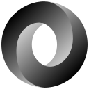

  <!-- ==================== HERO HEADER ==================== -->
  

  <!-- Animación de Typing Dinámica -->
  

    

  <!-- Presentación con Autoridad y Foco Técnico -->
  

    ¡Hola! Soy <b>Álvaro</b> 👋 
    <b>Ingeniero de Software & Desarrollador Python.</b> 
    Especializado en software de escritorio de alto rendimiento, procesamiento de audio/multimedia, 
    control de hardware a bajo nivel y arquitecturas de datos seguras y libres de dependencias en la nube. 
    Enfocado en el consumo mínimo de recursos, la estabilidad a prueba de fallos y el diseño moderno.
  

  <!-- Enlaces Rápidos & Métricas -->
  

    
    &nbsp;
    
    &nbsp;
    
    &nbsp;
    
  

  <!-- Enfoque Actual -->
  

    🔭 <b>En desarrollo activo:</b> Aplicaciones de escritorio nativas en Python y control de periféricos USB. 
    ⚡ <b>Filosofía de trabajo:</b> Eficiencia energética, código modular con suites de testing y ejecución local. 
    💬 <b>Hablemos de:</b> Python, arquitectura de software, ingeniería inversa o proyectos open-source.
  

 

---

### 🚀 Proyectos Destacados (Showcase)

  <table border="0" cellpadding="10" cellspacing="0">
    <tr>
      <td width="50%" valign="top">
        <h3 align="center">🎵 <a href="https://github.com/Zak208/Descargar_Musica">Descargador de Música</a></h3>
        
<i>Desktop Music Player & Streamlined Audio Engine</i>

        

          
          
          
          
          
        

        <ul>
          <li><b>Arquitectura 100% Local:</b> Reproductor con interfaz tipo Spotify, gestión de playlists, biblioteca y metadatos sin cuentas ni telemetría.</li>
          <li><b>Karaoke IA con Whisper:</b> Reconocimiento de voz local para generar y sincronizar letras palabra por palabra con precisión milimétrica.</li>
          <li><b>Pipeline de Distribución:</b> Actualizaciones automáticas OTA desde GitHub Releases y creador de instalador en un clic (Inno Setup).</li>
        </ul>
        

          <a href="https://github.com/Zak208/Descargar_Musica"><b>📦 Ver Código en GitHub</b></a> &nbsp;•&nbsp; 
          <a href="https://github.com/Zak208/Descargar_Musica/releases"><b>📥 Descargar Instalador (.exe)</b></a>
        

      </td>
      <td width="50%" valign="top">
        <h3 align="center">💡 <a href="https://github.com/Zak208/Zak_Light">Zak_Light</a></h3>
        
<i>Real-time Ambient Lighting & Audio Reactive Controller</i>

        

          
          
          
          
          
        

        <ul>
          <li><b>Sincronización de Monitor (Ambilight):</b> Captura de pantalla en tiempo real a 60 FPS con cálculo de color perimetral para tiras LED.</li>
          <li><b>Visualizador Reactivo de Audio:</b> Separación de frecuencias en graves, medios y agudos en directo con 18 modos y efectos dinámicos.</li>
          <li><b>Ingeniería de Fiabilidad:</b> Arquitectura multiproceso a prueba de cuelgues, control USB nativo y más de 560 pruebas unitarias.</li>
        </ul>
        

          <a href="https://github.com/Zak208/Zak_Light"><b>📦 Ver Código en GitHub</b></a> &nbsp;•&nbsp; 
          <a href="https://github.com/Zak208/Zak_Light/releases"><b>📥 Descargar Instalador (.exe)</b></a>
        

      </td>
    </tr>
  </table>

 

---

### 💻 Lenguajes de Programación

  <table border="0">
    <tr align="center">
      <td width="75"> <b>HTML5</b></td>
      <td width="75"> <b>CSS3</b></td>
      <td width="75"> <b>JavaScript</b></td>
      <td width="75"> <b>Python</b></td>
      <td width="75"> <b>JSON</b></td>
    </tr>
  </table>

---

### 🖥️ Sistemas Operativos

  <table border="0">
    <tr align="center">
      <td width="75"> <b>Linux</b></td>
      <td width="75"> <b>Android</b></td>
      <td width="75"> <b>Windows</b></td>
    </tr>
  </table>

---

### ⚡ Backend, Herramientas & DevOps

  <table border="0">
    <tr align="center">
      <td width="75"> <b>Discord.py</b></td>
      <td width="75"> <b>Discord.js</b></td>
      <td width="75"> <b>Node.js</b></td>
      <td width="75"> <b>Docker</b></td>
    </tr>
    <tr align="center">
      <td width="75"> <b>Git</b></td>
      <td width="75"> <b>MySQL</b></td>
      <td width="75"> <b>PostgreSQL</b></td>
      <td width="75"> <b>SQLite</b></td>
    </tr>
  </table>

 

---

### 📊 Estadísticas & Analíticas de GitHub

  
  &nbsp;
  

 

  

 

---

### 🕹️ Historial de Contribuciones

  <picture>
    <source media="(prefers-color-scheme: dark)" srcset="https://raw.githubusercontent.com/Zak208/Zak208/output/github-contribution-grid-snake-dark.svg">
    <source media="(prefers-color-scheme: light)" srcset="https://raw.githubusercontent.com/Zak208/Zak208/output/github-contribution-grid-snake.svg">
    
  </picture>

