  

 

  
  &nbsp;
  
  &nbsp;
  
  &nbsp;
  

---

<table>
  <tr>
    <td valign="top" align="center" width="44%">
      
    </td>
    <td valign="top" align="left" width="56%">
      <h3><code>$ whoami</code></h3>
      

        Soy <b>Álvaro</b> (<a href="https://github.com/Zak208">@Zak208</a>), desarrollador de software enfocado en rendimiento, interfaces interactivas y arquitectura eficiente.
      

      

        💻 <b>Fullstack &amp; UI:</b> Aplicaciones web interactivas con diseño moderno y micro-animaciones fluidas, respaldadas por backends asíncronos en Node.js y Python integrados a bases de datos relacionales (PostgreSQL).
      

      

        ⚙️ <b>Sistemas &amp; Hardware:</b> Software nativo para Windows con procesamiento de audio y vídeo en tiempo real (FFmpeg, Whisper AI) y comunicación a bajo nivel con periféricos mediante USB HID.
      

      

        <code>Python</code> <code>Node.js</code> <code>JavaScript</code> <code>HTML/CSS</code> <code>PostgreSQL</code> <code>FFmpeg</code> <code>USB HID</code>
      

      

        📌 <b>Proyectos destacados:</b> 
        🚀 <a href="https://github.com/Zak208/Descargar_Musica"><b>Descargador de Música</b></a> &nbsp;•&nbsp; 
        💡 <a href="https://github.com/Zak208/Zak_Light"><b>Zak Light</b></a> &nbsp;•&nbsp; 
        🌐 <a href="https://zak208.sytes.net"><b>Portafolio Web</b></a>
      

    </td>
  </tr>
</table>

---

## Proyectos destacados

### 🎵 [Descargador de Música](https://github.com/Zak208/Descargar_Musica)
Reproductor de escritorio local con sincronización de audio, interfaz tipo Spotify, gestión de listas, carátulas y metadatos sin telemetría. Usa **Python 3.12**, **FFmpeg**, **Whisper AI**. Instalador `.exe` con actualizaciones OTA.

**Tecnologías:** Python, FFmpeg, Whisper AI

### 💡 [Zak_Light](https://github.com/Zak208/Zak_Light)
Controlador de iluminación ambiental USB a 60 FPS, visualizador reactivo de audio con 18 modos, captura de pantalla perimetral sin retardo. Arquitectura multiproceso, más de 560 pruebas unitarias.

**Tecnologías:** Python, USB HID

### 🌐 [Portafolio Web Animado](https://zak208.sytes.net)
Sitio web personal responsive en modo oscuro, con micro‑interacciones, hover y transiciones fluidas. Deploy propio con certificado SSL.

**Tecnologías:** HTML5, CSS3, JavaScript, HTTPS

### 🤖 [Bot-Discord-Cogs](https://github.com/Zak208/Bot-Discord-Cogs)
Arquitectura modular para bots de Discord en Python, organización limpia de comandos, listeners y tareas asíncronas.

**Tecnologías:** Python, discord.py

---

## Tecnologías & herramientas

 **HTML5**
 **CSS3**
 **JavaScript**
 **React**
 **Node.js**
 **Python**
 **Git**
 **Docker**
 **PostgreSQL**
 **MySQL**
 **SQLite**
 **Discord.py**
 **Linux**
 **Windows**
 **VS Code**
 **PyCharm**

---

<h3 align="center">Actividad en GitHub</h3>

  
  &nbsp;
  

 

  

 

  <picture>
    <source media="(prefers-color-scheme: dark)" srcset="https://raw.githubusercontent.com/Zak208/Zak208/output/github-contribution-grid-snake-dark.svg">
    <source media="(prefers-color-scheme: light)" srcset="https://raw.githubusercontent.com/Zak208/Zak208/output/github-contribution-grid-snake.svg">
    
  </picture>

